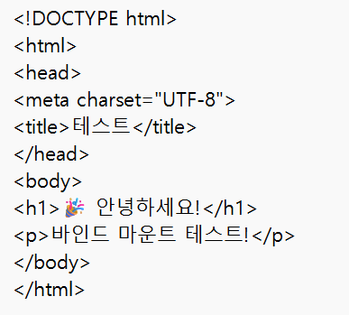

# 🐳 개발 워크스테이션 구축 (터미널 · Docker · Git)

> Windows 11 + WSL2(Ubuntu) + Docker Desktop 환경에서 터미널, Docker, Git/GitHub를 직접 세팅하고,
> 각 단계의 **명령어와 실행 결과**로 동작을 검증한 기록입니다.

<!--
  📝 작성 가이드 (제출 전에 이 주석은 지워도 됩니다)
  - "📝 TODO" 라고 적힌 곳은 직접 명령을 실행하고 출력 결과를 붙여넣어야 하는 부분입니다.
  - 출력은 반드시 코드블록(```) 안에, "$ 명령어" 줄과 "출력"이 함께 보이도록 넣습니다.
  - 토큰·비밀번호·이메일 등 민감정보는 **** 로 가립니다.
-->

---

## 목차

1. [프로젝트 개요](#1-프로젝트-개요)
2. [실행 환경](#2-실행-환경)
3. [수행 체크리스트](#3-수행-체크리스트)
4. [저장소 구조](#4-저장소-구조)
5. [터미널 조작 로그](#5-터미널-조작-로그)
6. [파일 권한 실습](#6-파일-권한-실습)
7. [Docker 설치 및 점검](#7-docker-설치-및-점검)
8. [Docker 기본 운영 명령](#8-docker-기본-운영-명령)
9. [컨테이너 실행 실습](#9-컨테이너-실행-실습)
10. [Dockerfile 커스텀 이미지](#10-dockerfile-커스텀-이미지)
11. [포트 매핑 접속](#11-포트-매핑-접속)
12. [바인드 마운트 반영](#12-바인드-마운트-반영)
13. [Docker 볼륨 영속성](#13-docker-볼륨-영속성)
14. [Git 설정 및 GitHub/VSCode 연동](#14-git-설정-및-githubvscode-연동)
15. [트러블슈팅](#15-트러블슈팅)
16. [검증 방법 요약](#16-검증-방법-요약)
17. [개념 정리](#17-개념-정리)
18. [보너스: Docker Compose](#18-보너스-docker-compose)
19. [재현 시 주의사항](#19-재현-시-주의사항)

---

## 1. 프로젝트 개요

**미션 목표:** 코드가 "내 컴퓨터에서만" 돌아가는 문제를 줄이고, 누구나 같은 방식으로 실행할 수 있는 개발 환경을 구성한다.

| 영역 | 한 일 |
|---|---|
| 터미널 | 디렉토리 생성·이동·복사·삭제 등 기본 조작, 파일/디렉토리 권한 변경 |
| Docker | 설치 점검, hello-world·ubuntu 컨테이너 실행, 운영 명령(logs/stats) 사용 |
| Dockerfile | `nginx:alpine`을 베이스로 커스텀 웹 서버 이미지 제작 |
| 포트/스토리지 | 포트 매핑 접속, 바인드 마운트로 변경 반영, 볼륨으로 데이터 영속성 검증 |
| Git/GitHub | 사용자 정보·기본 브랜치 설정, VSCode에서 GitHub 연동 후 푸시 |

---

## 2. 실행 환경

| 항목 | 값 |
|---|---|
| OS | Windows 11 (빌드 10.0.26300) |
| Linux 환경 | WSL2 + Ubuntu 📝 TODO: `lsb_release -a`의 Release 값 (예: 24.04) |
| 터미널 | Windows Terminal |
| 쉘 | 터미널/권한 실습: **bash (WSL Ubuntu)** / Docker·Git 실습: **PowerShell** |
| Docker | Docker Desktop (WSL2 백엔드) — Docker version 29.9.2, build a82e528 |
| Git | 📝 TODO: `git --version` 결과 |
| 에디터 | Visual Studio Code |

> 💡 Windows에서는 쉘마다 명령어가 다릅니다 (예: PowerShell의 `move` ↔ bash의 `mv`).
> 그래서 리눅스 명령어 실습은 WSL Ubuntu(bash)에서, Docker/Git은 PowerShell에서 진행했습니다.
> Docker Desktop의 WSL Integration을 켜면 Ubuntu 안에서도 같은 `docker` 명령을 쓸 수 있습니다.

WSL Ubuntu 설치 기록:


---

## 3. 수행 체크리스트

- [ ] [터미널 기본 조작](#5-터미널-조작-로그) (pwd, ls -la, cd, mkdir, cp, mv, rm, cat, touch)
- [ ] [권한 변경 실습](#6-파일-권한-실습) (파일 1개 + 디렉토리 1개, 변경 전/후)
- [ ] [Docker 설치/점검](#7-docker-설치-및-점검) (`docker --version`, `docker info`)
- [ ] [Docker 운영 명령](#8-docker-기본-운영-명령) (images, ps, ps -a, logs, stats)
- [ ] [hello-world 실행](#91-hello-world)
- [ ] [ubuntu 컨테이너 진입 + attach/exec 비교](#92-ubuntu-컨테이너)
- [x] [Dockerfile 커스텀 이미지 빌드/실행](#10-dockerfile-커스텀-이미지)
- [x] [포트 매핑 접속](#11-포트-매핑-접속) (8080 / 📝 8081 추가 예정)
- [x] [바인드 마운트 반영](#12-바인드-마운트-반영)
- [ ] [볼륨 영속성](#13-docker-볼륨-영속성)
- [ ] [Git 설정 + VSCode GitHub 연동](#14-git-설정-및-githubvscode-연동)
- [x] [트러블슈팅 2건 이상](#15-트러블슈팅)

> 📝 TODO: 각 항목을 완료하면 `[ ]` → `[x]` 로 바꾸세요.

---

## 4. 저장소 구조

```
dev-env-setup/
├── Dockerfile            # nginx:alpine 기반 커스텀 이미지 설계도
├── docker-compose.yml    # (보너스) Compose로 웹 서버 + 바인드 마운트 실행
├── html/
│   └── index.html        # 바인드 마운트로 컨테이너에 연결되는 웹 페이지
├── images/               # README에 첨부한 스크린샷
└── README.md             # 기술 문서 (이 파일)
```

---

## 5. 터미널 조작 로그

**환경:** WSL Ubuntu (bash), 작업 위치는 리눅스 홈 디렉토리(`~`)

> ⚠️ `/mnt/c/...` (Windows 드라이브)가 아니라 `~` 에서 작업했습니다. 이유는 [트러블슈팅 3](#트러블슈팅-3-windows-폴더에서-chmod가-적용되지-않음) 참고.

📝 TODO: 아래 명령을 WSL Ubuntu에서 순서대로 실행하고, 출력 결과를 그대로 붙여넣으세요.

```bash
# 1) 현재 위치 확인
$ pwd
(출력 붙여넣기)

# 2) 작업 디렉토리 생성 후 이동
$ mkdir -p ~/practice/terminal
$ cd ~/practice/terminal
$ pwd
(출력 붙여넣기)

# 3) 빈 파일 생성 + 숨김 파일 포함 목록 확인
$ touch empty.txt
$ echo "hello terminal" > memo.txt
$ touch .hidden
$ ls -la
(출력 붙여넣기 — .hidden 이 보여야 함)

# 4) 파일 내용 확인
$ cat memo.txt
(출력 붙여넣기)

# 5) 복사
$ cp memo.txt memo_copy.txt
$ ls -l
(출력 붙여넣기)

# 6) 이름 변경
$ mv memo_copy.txt renamed.txt
$ ls -l
(출력 붙여넣기)

# 7) 다른 디렉토리로 이동
$ mkdir backup
$ mv renamed.txt backup/
$ ls -l backup
(출력 붙여넣기)

# 8) 삭제 (파일, 디렉토리)
$ rm empty.txt
$ rm -r backup
$ ls -la
(출력 붙여넣기)
```

| 명령 | 의미 |
|---|---|
| `pwd` | 현재 위치(절대 경로) 출력 |
| `ls -la` | 숨김 파일(`.`으로 시작)까지 자세히 목록 출력 |
| `cd` / `mkdir -p` | 이동 / 상위 폴더까지 한 번에 생성 |
| `cp` / `mv` / `rm` | 복사 / 이동·이름변경 / 삭제 |
| `cat` / `touch` | 내용 출력 / 빈 파일 생성 |

---

## 6. 파일 권한 실습

📝 TODO: 아래를 WSL Ubuntu의 `~/practice/terminal` 에서 실행하고 결과를 붙여넣으세요.

### 6.1 파일 권한 변경 (644 → 755)

```bash
$ touch script.sh
$ ls -l script.sh          # 변경 전
(출력 붙여넣기 — 예: -rw-r--r-- ... script.sh)

$ chmod 755 script.sh
$ ls -l script.sh          # 변경 후
(출력 붙여넣기 — 예: -rwxr-xr-x ... script.sh)
```

### 6.2 디렉토리 권한 변경 (755 → 700)

```bash
$ mkdir secret_dir
$ ls -ld secret_dir        # 변경 전
(출력 붙여넣기 — 예: drwxr-xr-x ... secret_dir)

$ chmod 700 secret_dir
$ ls -ld secret_dir        # 변경 후
(출력 붙여넣기 — 예: drwx------ ... secret_dir)
```

### 6.3 결과 비교

| 대상 | 변경 전 | 변경 후 | 의미 |
|---|---|---|---|
| `script.sh` | `-rw-r--r--` (644) | `-rwxr-xr-x` (755) | 모두에게 실행 권한 추가 |
| `secret_dir/` | `drwxr-xr-x` (755) | `drwx------` (700) | 소유자만 접근 가능 |

> 권한 숫자 읽는 법은 [개념 정리 2](#172-파일-권한-rwx와-755644) 참고.

---

## 7. Docker 설치 및 점검

📝 TODO: PowerShell에서 실행 후 결과를 붙여넣으세요. (`docker info`는 길기 때문에 앞부분 20줄 정도만 발췌해도 됩니다.)

```powershell
PS> docker --version
Docker version 29.9.2, build a82e528

PS> docker info
(출력 붙여넣기 — Server: 부분에 Containers, Images, Server Version 이 보이면 데몬이 동작 중)
```

**확인 포인트:** `docker info` 출력에 `Server:` 섹션이 나오면 Docker 데몬(엔진)이 정상 실행 중입니다.
Docker Desktop이 꺼져 있으면 `error during connect` 에러가 납니다.

---

## 8. Docker 기본 운영 명령

📝 TODO: 아래 명령을 실행하고 결과를 붙여넣으세요.

```powershell
# 이미지 다운로드 / 목록
PS> docker pull nginx:alpine
(출력 붙여넣기)
PS> docker images
(출력 붙여넣기)

# 실행 중인 컨테이너 / 전체 컨테이너(종료된 것 포함)
PS> docker ps
(출력 붙여넣기)
PS> docker ps -a
(출력 붙여넣기)

# 컨테이너 중지 후 상태 확인
PS> docker stop my-web
PS> docker ps -a
(출력 붙여넣기 — STATUS가 Exited 로 바뀐 것 확인)
PS> docker start my-web

# 로그 확인 (브라우저로 접속한 기록이 남아 있음)
PS> docker logs my-web
(출력 붙여넣기 — "GET / HTTP/1.1" 200 같은 접속 로그)

# 리소스 사용량 (한 번만 출력)
PS> docker stats --no-stream
(출력 붙여넣기)
```

실행 중인 컨테이너 확인 (기존 기록):


---

## 9. 컨테이너 실행 실습

### 9.1 hello-world

📝 TODO

```powershell
PS> docker run hello-world
(출력 붙여넣기 — "Hello from Docker!" 문구 포함)
```

### 9.2 ubuntu 컨테이너

📝 TODO

```powershell
# 대화형으로 실행 후 내부 진입
PS> docker run -it --name my-ubuntu ubuntu bash
root@xxxx:/# ls
(출력 붙여넣기)
root@xxxx:/# echo "hello from container"
hello from container
root@xxxx:/# exit

PS> docker ps -a
(출력 붙여넣기 — my-ubuntu 가 Exited 상태인 것 확인)
```

### 9.3 attach vs exec 비교

📝 TODO

```powershell
# 백그라운드로 다시 시작
PS> docker start my-ubuntu

# (1) exec: 새로운 bash를 하나 더 열어서 들어감
PS> docker exec -it my-ubuntu bash
root@xxxx:/# exit
PS> docker ps
(출력 붙여넣기 — my-ubuntu 가 여전히 Up 상태)

# (2) attach: 컨테이너의 원래(메인) bash에 붙음
PS> docker attach my-ubuntu
root@xxxx:/# exit
PS> docker ps -a
(출력 붙여넣기 — my-ubuntu 가 Exited 로 바뀜)
```

**관찰 결과 정리**

| 구분 | `docker exec` | `docker attach` |
|---|---|---|
| 동작 | 컨테이너 안에 **새 프로세스**(bash)를 추가로 실행 | 컨테이너의 **메인 프로세스**에 화면만 연결 |
| `exit` 하면 | 내가 연 bash만 종료 → 컨테이너는 **계속 실행** | 메인 프로세스가 종료 → 컨테이너도 **종료** |
| 언제 쓰나 | 실행 중인 서버에 들어가서 점검할 때 | 메인 프로세스의 출력을 직접 볼 때 |

> 💡 attach 상태에서 컨테이너를 끄지 않고 빠져나오려면 `Ctrl + P` → `Ctrl + Q` 를 누릅니다.

---

## 10. Dockerfile 커스텀 이미지

### 10.1 선택한 방식: (A) 웹 서버 베이스 이미지 + 콘텐츠 교체

- **베이스 이미지:** `nginx:alpine` (공식 NGINX 이미지의 경량 Alpine Linux 버전)
- **선택 이유:** 웹 서버가 이미 설치·설정되어 있어서, 보여줄 페이지만 바꾸면 바로 웹 서비스를 띄울 수 있음

### 10.2 Dockerfile

```dockerfile
# 베이스 이미지: 가벼운 NGINX 웹서버
FROM nginx:alpine

# 작성자 정보
LABEL maintainer="KANG YERIM"
LABEL description="개발 환경 구축 과제용 커스텀 NGINX 이미지"

# 작업 디렉토리 설정
WORKDIR /usr/share/nginx/html

# 기본 index.html을 커스텀 페이지로 교체 (한글 깨짐 방지를 위해 charset 지정)
RUN echo '<!DOCTYPE html><html><head><meta charset="UTF-8"><title>Dev Env Setup</title></head><body style="font-family:sans-serif;text-align:center;padding:50px;"><h1>Hello from KANG YERIM Docker!</h1><p>개발 환경 구축 과제 성공!</p></body></html>' > index.html

# 80번 포트 노출
EXPOSE 80

# NGINX 실행
CMD ["nginx", "-g", "daemon off;"]
```

### 10.3 커스텀 포인트와 목적

| 커스텀 포인트 | 목적 |
|---|---|
| `LABEL maintainer / description` | 이미지 제작자와 용도를 메타데이터로 기록 (`docker inspect`로 확인 가능) |
| `WORKDIR /usr/share/nginx/html` | 이후 명령이 실행될 기준 폴더 지정 = NGINX가 웹 페이지를 읽는 폴더 |
| `RUN echo ... > index.html` | NGINX 기본 환영 페이지를 나만의 페이지로 교체 |
| `<meta charset="UTF-8">` | 한글이 깨지지 않도록 문자 인코딩 지정 ([트러블슈팅 2](#트러블슈팅-2-브라우저에서-한글이-깨져-보임)) |
| `EXPOSE 80` | 컨테이너가 80번 포트를 사용한다는 것을 문서화 |
| `CMD [...]` | 컨테이너 시작 시 NGINX를 포그라운드로 실행 (백그라운드로 가면 컨테이너가 바로 종료됨) |

### 10.4 빌드 및 실행

📝 TODO: Dockerfile 수정 후 다시 빌드하고 결과를 붙여넣으세요.

```powershell
PS> cd C:\dev\dev-env-setup
PS> docker build -t dev-env-nginx:1.0 .
(출력 붙여넣기 — 마지막에 "naming to docker.io/library/dev-env-nginx:1.0" 확인)

PS> docker images dev-env-nginx
(출력 붙여넣기)

PS> docker run -d -p 8080:80 --name my-web dev-env-nginx:1.0
(컨테이너 ID 출력)

PS> docker ps
(출력 붙여넣기)
```

---

## 11. 포트 매핑 접속

**구조:** `내 PC의 8080 포트` → `컨테이너의 80 포트(NGINX)`

```
브라우저 ──▶ localhost:8080 ──(포트 매핑 -p 8080:80)──▶ 컨테이너:80 ──▶ NGINX
```

### 11.1 8080 포트 접속

📝 TODO: Dockerfile 수정·재빌드 후 다시 캡처해서 아래 이미지를 교체하세요. (주소창 `localhost:8080`이 보이게)

```powershell
PS> curl.exe http://localhost:8080
(출력 붙여넣기 — HTML 코드가 응답으로 나옴)
```


### 11.2 같은 이미지를 8081 포트로 한 번 더 실행

📝 TODO: 같은 이미지로 컨테이너를 2개 띄울 수 있음을 보여주는 실습입니다.

```powershell
PS> docker run -d -p 8081:80 --name my-web-8081 dev-env-nginx:1.0
PS> docker ps
(출력 붙여넣기 — 8080, 8081 두 컨테이너가 모두 Up)
PS> curl.exe http://localhost:8081
(출력 붙여넣기)
```

📝 TODO: `localhost:8081` 브라우저 캡처 첨부 → ``

> 💡 PowerShell에서 그냥 `curl`은 다른 명령(`Invoke-WebRequest`)으로 동작하므로 `curl.exe`로 입력합니다.

---

## 12. 바인드 마운트 반영

**바인드 마운트:** 내 PC의 폴더(`./html`)를 컨테이너 폴더(`/usr/share/nginx/html`)에 **직접 연결**. 내 PC에서 파일을 고치면 이미지를 다시 빌드하지 않아도 바로 반영됩니다.

### 12.1 실행 명령

`docker-compose.yml`로 실행했습니다 (`volumes: - ./html:/usr/share/nginx/html`).
같은 동작을 `docker run`으로 쓰면 아래와 같습니다.

```powershell
# Compose 방식 (실제 사용)
PS> docker compose up -d
(출력 붙여넣기)

# docker run 방식 (동일한 의미)
PS> docker run -d -p 8080:80 -v ${PWD}/html:/usr/share/nginx/html --name dev-web nginx:alpine
```

> ⚠️ `my-web` 컨테이너가 8080을 쓰고 있으면 충돌하므로 먼저 `docker rm -f my-web` 으로 정리합니다.

### 12.2 변경 전 / 후 비교

📝 TODO: 각 단계에서 `type html\index.html` (PowerShell) 출력도 함께 붙여넣으면 더 확실합니다.

**① 변경 전** — `html/index.html` 내용과 브라우저 화면




**② 호스트에서 `html/index.html` 수정** (컨테이너 재시작·재빌드 없이 새로고침만)

```html
<h1>🚀 Docker 마스터!</h1>
<p>바인드 마운트 완벽 이해! ✨</p>
<p>오늘도 열심히 공부 중! 💪</p>
```

**③ 변경 후** — 새로고침만으로 바로 반영됨


---

## 13. Docker 볼륨 영속성

**볼륨:** Docker가 직접 관리하는 저장 공간. 컨테이너를 삭제해도 볼륨 안의 데이터는 남습니다.

📝 TODO: 아래 명령을 순서대로 실행하고 결과를 붙여넣으세요.

```powershell
# 1) 볼륨 생성 및 확인
PS> docker volume create mydata
PS> docker volume ls
(출력 붙여넣기)

# 2) 볼륨을 연결한 컨테이너 실행 후 데이터 쓰기
PS> docker run -d --name vol-test -v mydata:/data ubuntu sleep infinity
PS> docker exec vol-test bash -c "echo 'volume persistence test' > /data/hello.txt"
PS> docker exec vol-test cat /data/hello.txt
volume persistence test

# 3) 컨테이너 삭제
PS> docker rm -f vol-test
PS> docker ps -a
(출력 붙여넣기 — vol-test 가 사라진 것 확인)

# 4) 새 컨테이너에 같은 볼륨 연결 후 데이터 확인
PS> docker run -d --name vol-test2 -v mydata:/data ubuntu sleep infinity
PS> docker exec vol-test2 cat /data/hello.txt
(출력 붙여넣기 — 같은 문구가 나오면 성공!)
```

**결론:** 컨테이너(`vol-test`)를 삭제한 뒤 새 컨테이너(`vol-test2`)에서도 `hello.txt`가 그대로 남아 있음 → 데이터가 컨테이너가 아닌 **볼륨에 저장**되기 때문.

---

## 14. Git 설정 및 GitHub/VSCode 연동

### 14.1 Git 사용자 정보 및 기본 브랜치 설정

📝 TODO

```powershell
PS> git --version
(출력 붙여넣기)

PS> git config --global user.name "KANG YERIM"
PS> git config --global user.email "****@****.com"
PS> git config --global init.defaultBranch main

PS> git config --list
(출력 붙여넣기 — user.email 은 ****로 가리기)
```

### 14.2 GitHub 저장소 생성 및 연동

GitHub에서 Public 저장소 생성:


로컬로 클론:

```powershell
PS C:\dev> git clone https://github.com/kangyerimi/dev-env-setup.git
Cloning into 'dev-env-setup'...
remote: Enumerating objects: 6, done.
remote: Counting objects: 100% (6/6), done.
remote: Compressing objects: 100% (5/5), done.
remote: Total 6 (delta 0), reused 6 (delta 0), pack-reused 0 (from 0)
Receiving objects: 100% (6/6), 237.37 KiB | 21.58 MiB/s, done.
```

📝 TODO: 원격 저장소 연결 확인

```powershell
PS> git remote -v
(출력 붙여넣기)
PS> git log --oneline
(출력 붙여넣기)
```

### 14.3 VSCode GitHub 로그인 증거

📝 TODO: 아래 2장을 캡처해서 첨부하세요.

1. VSCode 왼쪽 아래 **계정 아이콘(사람 모양)** 클릭 → GitHub 계정으로 로그인된 화면
2. VSCode **소스 제어(Source Control)** 탭에서 이 저장소가 열려 있고 커밋/푸시한 화면

```


```

---

## 15. 트러블슈팅

### 트러블슈팅 1: 바인드 마운트 후 `403 Forbidden`

| 단계 | 내용 |
|---|---|
| **문제** | `docker compose up -d` 후 `localhost:8080` 접속 시 `403 Forbidden` 표시 |
| **원인 가설** | NGINX가 보여줄 `index.html`을 찾지 못하는 것 같다 |
| **확인** | `index.html`이 `html/` 폴더 **밖**(프로젝트 루트)에 있었음. 바인드 마운트는 `./html` 폴더를 컨테이너의 `/usr/share/nginx/html`에 **덮어씌우기** 때문에, 빈 폴더가 연결되어 NGINX 기본 페이지까지 가려짐 → 보여줄 파일이 없고 폴더 목록 보기도 꺼져 있어 403 발생 |
| **해결** | `index.html`을 `html/` 폴더 안으로 이동 후 새로고침 → 정상 표시 |
| **배운 점** | 바인드 마운트는 컨테이너 안의 기존 내용을 **가린다**. 마운트할 호스트 폴더 구조를 먼저 확인해야 함 |


```powershell
PS C:\dev\dev-env-setup> move index.html html\
PS C:\dev\dev-env-setup> ls html

    디렉터리: C:\dev\dev-env-setup\html

Mode                 LastWriteTime         Length Name
----                 -------------         ------ ----
-a----        2026-11-04   오후 1:58            249 index.html
```

### 트러블슈팅 2: 브라우저에서 한글이 깨져 보임

| 단계 | 내용 |
|---|---|
| **문제** | 커스텀 이미지 접속 시 영어(`Hello from KANG YERIM Docker!`)는 정상인데 한글 문장이 `媛쒕컻...` 처럼 깨짐 |
| **원인 가설** | 문자 인코딩(UTF-8) 정보가 브라우저에 전달되지 않았다 |
| **확인** | ① Dockerfile의 `RUN echo` HTML에 `<meta charset="UTF-8">`이 **없었음**. ② 반면 `html/index.html`에는 meta charset이 있었고, 바인드 마운트 화면에서는 한글이 정상 표시됨 → 인코딩 지정 여부가 차이 |
| **해결** | Dockerfile의 HTML `<head>`에 `<meta charset="UTF-8">` 추가 → 재빌드 → 한글 정상 표시 |
| **배운 점** | 브라우저는 인코딩 정보가 없으면 OS 기본값(한국어 Windows는 EUC-KR 계열)으로 추측한다. 웹 페이지는 항상 UTF-8을 명시하자 |


📝 TODO: 수정 후 한글이 정상으로 나오는 화면 캡처 첨부 → ``

### 트러블슈팅 3: Windows 폴더에서 chmod가 적용되지 않음

> 📝 TODO: 직접 겪었다면 출력 결과를 넣고, 아니라면 이 항목은 삭제해도 됩니다 (필수는 2건).
> 확인 방법: WSL에서 `cd /mnt/c/Users/<사용자명>` 후 `touch test.txt; chmod 600 test.txt; ls -l test.txt` 실행

| 단계 | 내용 |
|---|---|
| **문제** | WSL에서 `/mnt/c/...` 폴더의 파일에 `chmod 600`을 했는데 `ls -l` 결과가 `-rwxrwxrwx`로 그대로 |
| **원인 가설** | Windows 파일 시스템(NTFS)은 리눅스 권한 체계를 그대로 지원하지 않는다 |
| **확인** | 리눅스 홈(`~`)에서 같은 명령을 실행하니 권한이 정상적으로 바뀜 |
| **해결** | 권한 실습은 WSL 리눅스 파일 시스템(`~`)에서 진행 |

---

## 16. 검증 방법 요약

| 항목 | 검증 명령 | 확인한 것 | 증거 위치 |
|---|---|---|---|
| 터미널 조작 | `pwd`, `ls -la` 등 | 파일 생성·복사·이동·삭제 결과 | [5장](#5-터미널-조작-로그) |
| 권한 | `ls -l`, `chmod` | 권한 문자열 변경 전/후 | [6장](#6-파일-권한-실습) |
| Docker 설치 | `docker --version`, `docker info` | 버전, 데몬(Server) 동작 | [7장](#7-docker-설치-및-점검) |
| 운영 명령 | `docker ps -a`, `logs`, `stats` | 컨테이너 상태·로그·리소스 | [8장](#8-docker-기본-운영-명령) |
| 컨테이너 실행 | `docker run hello-world`, `exec`, `attach` | 실행 성공, exit 후 상태 차이 | [9장](#9-컨테이너-실행-실습) |
| 커스텀 이미지 | `docker build`, `docker run` | 빌드 성공, 컨테이너 Up | [10장](#10-dockerfile-커스텀-이미지) |
| 포트 매핑 | 브라우저, `curl.exe` | `localhost:8080`, `8081` 응답 | [11장](#11-포트-매핑-접속) |
| 바인드 마운트 | 파일 수정 후 새로고침 | 재빌드 없이 즉시 반영 | [12장](#12-바인드-마운트-반영) |
| 볼륨 | 컨테이너 삭제 후 `cat` | 데이터 유지 | [13장](#13-docker-볼륨-영속성) |
| Git/GitHub | `git config --list`, VSCode | 설정값, 로그인·연동 | [14장](#14-git-설정-및-githubvscode-연동) |

---

## 17. 개념 정리

### 17.1 절대 경로 vs 상대 경로

- **절대 경로:** 최상위(`/`)부터 시작하는 **전체 주소**. 어디서 실행해도 같은 위치를 가리킴.
  예) `/home/yerim/practice/terminal/memo.txt`
- **상대 경로:** **현재 위치 기준** 주소. `.`은 현재 폴더, `..`은 상위 폴더.
  예) 현재 위치가 `/home/yerim/practice`일 때 `terminal/memo.txt`, `../practice/terminal`
- 비유: 절대 경로는 "서울시 강남구 ○○로 12", 상대 경로는 "여기서 두 블록 앞".

### 17.2 파일 권한 (r/w/x)와 755·644

`ls -l` 결과 `-rwxr-xr-x`는 맨 앞 1글자(파일 종류: `-` 파일, `d` 디렉토리) + 3글자씩 3묶음입니다.

| 묶음 | 소유자(user) | 그룹(group) | 그 외(others) |
|---|---|---|---|
| 예시 | `rwx` | `r-x` | `r-x` |
| 숫자 | 4+2+1 = **7** | 4+0+1 = **5** | 4+0+1 = **5** |

- `r`(읽기)=4, `w`(쓰기)=2, `x`(실행)=1 을 더한 값
- **755** = 소유자는 전부 가능, 나머지는 읽기·실행만 → 실행 파일, 디렉토리에 주로 사용
- **644** = 소유자는 읽기·쓰기, 나머지는 읽기만 → 일반 파일에 주로 사용
- 디렉토리에서 `x`는 "그 폴더 안으로 들어갈(cd) 수 있는 권한"

### 17.3 커스텀 이미지

이미 만들어진 이미지(`nginx:alpine`)를 `FROM`으로 가져와 그 위에 필요한 것만 덧붙여 새 이미지를 만드는 것.
처음부터 웹 서버를 설치할 필요 없이 **"검증된 베이스 + 내 변경분"** 만 관리하면 됩니다.
이미지는 설계도(붕어빵 틀), 컨테이너는 그 설계도로 실행한 실체(붕어빵)입니다.

### 17.4 포트 매핑이 필요한 이유

컨테이너는 내 PC와 **격리된 별도 네트워크**에서 실행됩니다. 컨테이너 안의 NGINX가 80번 포트를 열어도 바깥(내 PC 브라우저)에서는 바로 접근할 수 없습니다.
`-p 8080:80`은 "내 PC 8080번으로 들어온 요청을 컨테이너 80번으로 전달하라"는 연결 통로입니다.
덕분에 같은 이미지를 8080, 8081처럼 다른 포트로 여러 개 띄울 수도 있습니다.

### 17.5 Docker 볼륨 (영속 데이터)

컨테이너 내부 파일은 컨테이너를 삭제하면 함께 사라집니다. 볼륨은 Docker가 관리하는 **컨테이너 바깥의 저장 공간**이라, 컨테이너를 지우고 새로 만들어도 데이터가 유지됩니다. (DB 데이터, 업로드 파일 등에 사용)

| 구분 | 바인드 마운트 | 볼륨 |
|---|---|---|
| 저장 위치 | 내가 지정한 호스트 폴더 (`./html`) | Docker가 관리하는 영역 |
| 주 용도 | 개발 중 코드/파일 즉시 반영 | 데이터 영구 보관 |
| 예시 옵션 | `-v ${PWD}/html:/usr/share/nginx/html` | `-v mydata:/data` |

### 17.6 Git vs GitHub

| 구분 | Git | GitHub |
|---|---|---|
| 정체 | 내 PC에 설치하는 **버전 관리 프로그램** | Git 저장소를 올려두는 **온라인 서비스** |
| 역할 | 변경 이력 저장(commit), 브랜치 관리 | 원격 백업, 공유, 협업(PR, 이슈) |
| 인터넷 | 없어도 사용 가능 | 필요 |
| 비유 | 게임의 세이브 기능 | 세이브 파일을 올리는 클라우드 |

---

## 18. 보너스: Docker Compose

`docker run` 옵션(포트, 마운트, 이름 등)을 **파일로 문서화**해서 `docker compose up` 한 줄로 같은 환경을 재현할 수 있습니다.

```yaml
services:
  web:
    image: nginx:alpine
    container_name: dev-web
    ports:
      - "8080:80"
    volumes:
      - ./html:/usr/share/nginx/html
    restart: unless-stopped
```

📝 TODO: 운영 명령 결과를 붙여넣으세요.

```powershell
PS> docker compose up -d
PS> docker compose ps
(출력 붙여넣기)
PS> docker compose logs
(출력 붙여넣기)
PS> docker compose down
(출력 붙여넣기)
```

---

## 19. 재현 시 주의사항

```powershell
git clone https://github.com/kangyerimi/dev-env-setup.git
cd dev-env-setup

# 커스텀 이미지
docker build -t dev-env-nginx:1.0 .
docker run -d -p 8080:80 --name my-web dev-env-nginx:1.0
# → http://localhost:8080

# 바인드 마운트 (Compose)
docker rm -f my-web
docker compose up -d
# → http://localhost:8080, html/index.html 수정 후 새로고침
```

- **Docker Desktop이 실행 중**이어야 합니다 (트레이 아이콘의 고래가 초록색/Running).
- 8080 포트를 다른 프로그램이 쓰고 있으면 `-p 8090:80`처럼 호스트 포트만 바꾸면 됩니다.
- `${PWD}`는 PowerShell 문법입니다. Git Bash/WSL에서는 `$(pwd)`를 사용하세요.
- 권한 실습(`chmod`)은 WSL의 리눅스 홈(`~`)에서 해야 결과가 정상적으로 보입니다.

---

## 🔒 보안

- 이 문서와 스크린샷에는 비밀번호, 토큰, 개인키가 포함되어 있지 않습니다.
- `git config --list` 출력의 이메일은 마스킹했습니다.
- GitHub 인증은 VSCode 로그인(브라우저 OAuth)으로 진행하여 토큰을 직접 다루지 않았습니다.