# 🐳 개발 워크스테이션 구축 (터미널 · Docker · Git)

> Windows 11 + WSL2(Ubuntu) + Docker Desktop 환경에서 터미널, Docker, Git/GitHub를 직접 세팅하고,
> 각 단계의 **명령어와 실행 결과**로 동작을 검증한 기록입니다.


---

## 목차

1. [프로젝트 개요](#1-프로젝트-개요)
2. [실행 환경](#2-실행-환경)
3. [수행 체크리스트](#3-수행-체크리스트)
4. [저장소 구조](#4-저장소-구조)
5. [터미널 조작 로그](#5-터미널-조작-로그)
6. [파일 권한 실습](#6-파일-권한-실습)
7. [Docker 설치 및 점검](#7-docker-설치-및-점검)
8. [Docker 기본 운영 명령](#8-docker-기본-운영-명령)
9. [컨테이너 실행 실습](#9-컨테이너-실행-실습)
10. [Dockerfile 커스텀 이미지](#10-dockerfile-커스텀-이미지)
11. [포트 매핑 접속](#11-포트-매핑-접속)
12. [바인드 마운트 반영](#12-바인드-마운트-반영)
13. [Docker 볼륨 영속성](#13-docker-볼륨-영속성)
14. [Git 설정 및 GitHub/VSCode 연동](#14-git-설정-및-githubvscode-연동)
15. [트러블슈팅](#15-트러블슈팅)
16. [검증 방법 요약](#16-검증-방법-요약)
17. [개념 정리](#17-개념-정리)
18. [보너스: Docker Compose](#18-보너스-docker-compose)
19. [재현 시 주의사항](#19-재현-시-주의사항)

---

## 1. 프로젝트 개요

**미션 목표:** 코드가 "내 컴퓨터에서만" 돌아가는 문제를 줄이고, 누구나 같은 방식으로 실행할 수 있는 개발 환경을 구성한다.

| 영역 | 한 일 |
|---|---|
| 터미널 | 디렉토리 생성·이동·복사·삭제 등 기본 조작, 파일/디렉토리 권한 변경 |
| Docker | 설치 점검, hello-world·ubuntu 컨테이너 실행, 운영 명령(logs/stats) 사용 |
| Dockerfile | `nginx:alpine`을 베이스로 커스텀 웹 서버 이미지 제작 |
| 포트/스토리지 | 포트 매핑 접속, 바인드 마운트로 변경 반영, 볼륨으로 데이터 영속성 검증 |
| Git/GitHub | 사용자 정보·기본 브랜치 설정, VSCode에서 GitHub 연동 후 푸시 |

---

## 2. 실행 환경

| 항목 | 값 |
|---|---|
| OS | Windows 11 (빌드 10.0.26300) |
| Linux 환경 | WSL2 + Ubuntu 24.04 |
| 터미널 | Windows Terminal |
| 쉘 | 터미널/권한 실습: **bash (WSL Ubuntu)** / Docker·Git 실습: **PowerShell** |
| Docker | Docker Desktop (WSL2 백엔드) — Docker version 29.9.2, build a82e528 |
| Git | git version 2.56.0.windows.4 |
| 에디터 | Visual Studio Code |

> 💡 Windows에서는 쉘마다 명령어가 다릅니다 (예: PowerShell의 `move` ↔ bash의 `mv`).
> 그래서 리눅스 명령어 실습은 WSL Ubuntu(bash)에서, Docker/Git은 PowerShell에서 진행했습니다.
> Docker Desktop의 WSL Integration을 켜면 Ubuntu 안에서도 같은 `docker` 명령을 쓸 수 있습니다.

WSL Ubuntu 설치 기록:

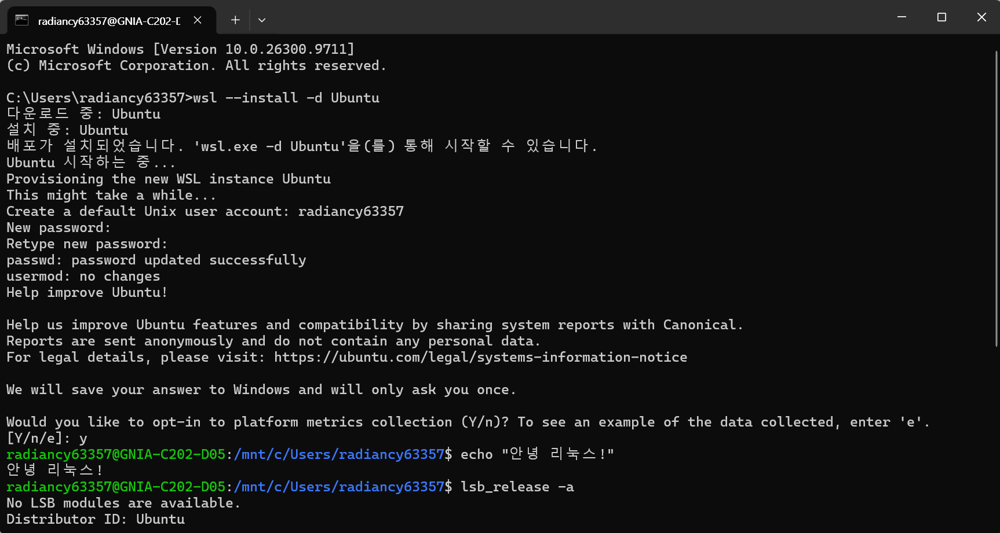

---

## 3. 수행 체크리스트

- [x] [터미널 기본 조작](#5-터미널-조작-로그) (pwd, ls -la, cd, mkdir, cp, mv, rm, cat, touch)
- [x] [권한 변경 실습](#6-파일-권한-실습) (파일 1개 + 디렉토리 1개, 변경 전/후)
- [x] [Docker 설치/점검](#7-docker-설치-및-점검) (`docker --version`, `docker info`)
- [x] [Docker 운영 명령](#8-docker-기본-운영-명령) (images, ps, ps -a, logs, stats)
- [x] [hello-world 실행](#91-hello-world)
- [x] [ubuntu 컨테이너 진입 + attach/exec 비교](#92-ubuntu-컨테이너)
- [x] [Dockerfile 커스텀 이미지 빌드/실행](#10-dockerfile-커스텀-이미지)
- [x] [포트 매핑 접속](#11-포트-매핑-접속) (8080, 8081 두 번)
- [x] [바인드 마운트 반영](#12-바인드-마운트-반영)
- [x] [볼륨 영속성](#13-docker-볼륨-영속성)
- [x] [Git 설정 + VSCode GitHub 연동](#14-git-설정-및-githubvscode-연동)
- [x] [트러블슈팅 2건 이상](#15-트러블슈팅) (3건)
- [x] [보너스: Docker Compose](#18-보너스-docker-compose)

---

## 4. 저장소 구조

```
dev-env-setup/
├── Dockerfile            # nginx:alpine 기반 커스텀 이미지 설계도
├── docker-compose.yml    # (보너스) Compose로 웹 서버 + 바인드 마운트 실행
├── html/
│   └── index.html        # 바인드 마운트로 컨테이너에 연결되는 웹 페이지
├── images/               # README에 첨부한 스크린샷
└── README.md             # 기술 문서 (이 파일)
```

---

## 5. 터미널 조작 로그

**환경:** WSL Ubuntu (bash), 작업 위치는 리눅스 홈 디렉토리(`~`)


```bash
radiancy63357@GNIA-C202-D05:~$ pwd
/home/radiancy63357
radiancy63357@GNIA-C202-D05:~$ mkdir -p ~/practice/terminal
radiancy63357@GNIA-C202-D05:~$ cd ~/practice/terminal
radiancy63357@GNIA-C202-D05:~/practice/terminal$ pwd
/home/radiancy63357/practice/terminal
radiancy63357@GNIA-C202-D05:~/practice/terminal$ touch empty.txt
radiancy63357@GNIA-C202-D05:~/practice/terminal$ echo "hello terminal" > memo.txt
radiancy63357@GNIA-C202-D05:~/practice/terminal$ touch .hidden
radiancy63357@GNIA-C202-D05:~/practice/terminal$ ls -la
total 12
drwxr-xr-x 2 radiancy63357 radiancy63357 4096 Nov  8 11:32 .
drwxr-xr-x 3 radiancy63357 radiancy63357 4096 Nov  8 11:32 ..
-rw-r--r-- 1 radiancy63357 radiancy63357    0 Nov  8 11:32 .hidden
-rw-r--r-- 1 radiancy63357 radiancy63357    0 Nov  8 11:32 empty.txt
-rw-r--r-- 1 radiancy63357 radiancy63357   15 Nov  8 11:32 memo.txt
radiancy63357@GNIA-C202-D05:~/practice/terminal$ cat memo.txt
hello terminal
radiancy63357@GNIA-C202-D05:~/practice/terminal$ cp memo.txt memo_copy.txt
radiancy63357@GNIA-C202-D05:~/practice/terminal$ ls -l
total 8
-rw-r--r-- 1 radiancy63357 radiancy63357  0 Nov  8 11:32 empty.txt
-rw-r--r-- 1 radiancy63357 radiancy63357 15 Nov  8 11:32 memo.txt
-rw-r--r-- 1 radiancy63357 radiancy63357 15 Nov  8 11:32 memo_copy.txt
radiancy63357@GNIA-C202-D05:~/practice/terminal$ mv memo_copy.txt renamed.txt
radiancy63357@GNIA-C202-D05:~/practice/terminal$ ls -l
total 8
-rw-r--r-- 1 radiancy63357 radiancy63357  0 Nov  8 11:32 empty.txt
-rw-r--r-- 1 radiancy63357 radiancy63357 15 Nov  8 11:32 memo.txt
-rw-r--r-- 1 radiancy63357 radiancy63357 15 Nov  8 11:32 renamed.txt
radiancy63357@GNIA-C202-D05:~/practice/terminal$ mkdir backup
radiancy63357@GNIA-C202-D05:~/practice/terminal$ mv renamed.txt backup/
radiancy63357@GNIA-C202-D05:~/practice/terminal$ ls -l backup
total 4
-rw-r--r-- 1 radiancy63357 radiancy63357 15 Nov  8 11:32 renamed.txt
radiancy63357@GNIA-C202-D05:~/practice/terminal$ rm empty.txt
radiancy63357@GNIA-C202-D05:~/practice/terminal$ rm -r backup
radiancy63357@GNIA-C202-D05:~/practice/terminal$ ls -la
total 12
drwxr-xr-x 2 radiancy63357 radiancy63357 4096 Nov  8 11:32 .
drwxr-xr-x 3 radiancy63357 radiancy63357 4096 Nov  8 11:32 ..
-rw-r--r-- 1 radiancy63357 radiancy63357    0 Nov  8 11:32 .hidden
-rw-r--r-- 1 radiancy63357 radiancy63357   15 Nov  8 11:32 memo.txt
```

| 명령 | 의미 |
|---|---|
| `pwd` | 현재 위치(절대 경로) 출력 |
| `ls -la` | 숨김 파일(`.`으로 시작)까지 자세히 목록 출력 |
| `cd` / `mkdir -p` | 이동 / 상위 폴더까지 한 번에 생성 |
| `cp` / `mv` / `rm` | 복사 / 이동·이름변경 / 삭제 |
| `cat` / `touch` | 내용 출력 / 빈 파일 생성 |

---

## 6. 파일 권한 실습


### 6.1 파일 권한 변경 (644 → 755)

```bash
radiancy63357@GNIA-C202-D05:~$ touch script.sh
radiancy63357@GNIA-C202-D05:~$ ls -l script.sh
-rw-r--r-- 1 radiancy63357 radiancy63357 0 Nov  8 11:45 script.sh
radiancy63357@GNIA-C202-D05:~$ chmod 755 script.sh
radiancy63357@GNIA-C202-D05:~$ ls -l script.sh
-rwxr-xr-x 1 radiancy63357 radiancy63357 0 Nov  8 11:45 script.sh
```

### 6.2 디렉토리 권한 변경 (755 → 700)

```bash
radiancy63357@GNIA-C202-D05:~$ mkdir secret_dir
radiancy63357@GNIA-C202-D05:~$ ls -ld secret_dir
drwxr-xr-x 2 radiancy63357 radiancy63357 4096 Nov  8 11:45 secret_dir
radiancy63357@GNIA-C202-D05:~$ chmod 700 secret_dir
radiancy63357@GNIA-C202-D05:~$ ls -ld secret_dir
drwx------ 2 radiancy63357 radiancy63357 4096 Nov  8 11:45 secret_dir
```

### 6.3 결과 비교

| 대상 | 변경 전 | 변경 후 | 의미 |
|---|---|---|---|
| `script.sh` | `-rw-r--r--` (644) | `-rwxr-xr-x` (755) | 모두에게 실행 권한 추가 |
| `secret_dir/` | `drwxr-xr-x` (755) | `drwx------` (700) | 소유자만 접근 가능 |

> 권한 숫자 읽는 법은 [개념 정리 2](#172-파일-권한-rwx와-755644) 참고.

---

## 7. Docker 설치 및 점검


```powershell
PS> docker --version
Docker version 29.9.2, build a82e528

PS> docker info
Client:
 Version:    29.9.2
 Context:    desktop-linux
 (플러그인 목록 생략)

Server:
 Containers: 1
  Running: 1
  Paused: 0
  Stopped: 0
 Images: 3
 Server Version: 29.9.2
 Storage Driver: overlayfs
 Cgroup Version: 2
 Kernel Version: 6.18.54.1-microsoft-standard-WSL2
 Operating System: Docker Desktop
 OSType: linux
 Architecture: x86_64
 CPUs: 24
 Total Memory: 15.25GiB
 Name: docker-desktop
```

**확인 포인트:** `docker info` 출력에 `Server:` 섹션이 나오면 Docker 데몬(엔진)이 정상 실행 중입니다.
Docker Desktop이 꺼져 있으면 `error during connect` 에러가 납니다.

---

## 8. Docker 기본 운영 명령


```powershell
PS> docker pull nginx:alpine
alpine: Pulling from library/nginx
da90db506dd5: Pull complete
...
Digest: sha256:713fc2ebfd92e8217db451477182ee91944b123d2b1ee9fd5a8c6e91ca6c3a11
Status: Downloaded newer image for nginx:alpine
docker.io/library/nginx:alpine

PS> docker images
IMAGE                ID             DISK USAGE   CONTENT SIZE   EXTRA
dev-env-nginx:1.0    e36abcadef99       93.6MB         26.3MB    U
hello-world:latest   c567b231f656       25.9kB         9.49kB
nginx:alpine         713fc2ebfd92       94.5MB         27.3MB

PS> docker ps -a
CONTAINER ID   IMAGE               COMMAND                   CREATED          STATUS          PORTS                                     NAMES
b36b991056c0   dev-env-nginx:1.0   "/docker-entrypoint.…"   10 minutes ago   Up 10 minutes   0.0.0.0:8081->80/tcp, [::]:8081->80/tcp   my-web-8081
e755f7c6e2f6   dev-env-nginx:1.0   "/docker-entrypoint.…"   20 minutes ago   Up 20 minutes   0.0.0.0:8080->80/tcp, [::]:8080->80/tcp   my-web

PS> docker stop my-web
my-web

PS> docker ps -a
CONTAINER ID   IMAGE               COMMAND                   CREATED          STATUS                     PORTS                                     NAMES
b36b991056c0   dev-env-nginx:1.0   "/docker-entrypoint.…"   10 minutes ago   Up 10 minutes              0.0.0.0:8081->80/tcp, [::]:8081->80/tcp   my-web-8081
e755f7c6e2f6   dev-env-nginx:1.0   "/docker-entrypoint.…"   21 minutes ago   Exited (0) 7 seconds ago                                             my-web

PS> docker start my-web
my-web

PS> docker logs my-web
/docker-entrypoint.sh: Configuration complete; ready for start up
2026/11/08 03:08:03 [notice] 1#1: nginx/1.31.8
2026/11/08 03:08:03 [notice] 1#1: start worker processes
...
172.17.0.1 - - [08/Nov/2026:03:10:40 +0000] "GET / HTTP/1.1" 200 248 "-" "Mozilla/5.0 (Windows NT 10.0; Win64; x64) ... Edg/157.0.0.0" "-"
172.17.0.1 - - [08/Nov/2026:03:15:57 +0000] "GET / HTTP/1.1" 200 248 "-" "curl/8.21.0" "-"
172.17.0.1 - - [08/Nov/2026:03:19:24 +0000] "GET / HTTP/1.1" 304 0 "-" "Mozilla/5.0 ... Edg/157.0.0.0" "-"
2026/11/08 03:29:03 [notice] 1#1: signal 3 (SIGQUIT) received, shutting down
...
2026/11/08 03:29:03 [notice] 1#1: exit
/docker-entrypoint.sh: Configuration complete; ready for start up
2026/11/08 03:29:17 [notice] 1#1: start worker processes

PS> docker stats --no-stream
CONTAINER ID   NAME          CPU %     MEM USAGE / LIMIT     MEM %     NET I/O           BLOCK I/O     PIDS
b36b991056c0   my-web-8081   0.00%     18.24MiB / 15.25GiB   0.12%     4.37kB / 3.53kB   0B / 12.3kB   25
e755f7c6e2f6   my-web        0.00%     20.68MiB / 15.25GiB   0.13%     872B / 126B       0B / 0B       25
```
**확인한 것**
- `docker stop` 후 `STATUS`가 `Up` → `Exited (0)` 으로 바뀜 (0 = 정상 종료)
- `docker logs`에 브라우저(Edg)와 curl의 접속 기록(`GET / ... 200`)이 남아 있음
- 로그의 `SIGQUIT received, shutting down` 은 `docker stop` 명령으로 NGINX가 종료된 기록이고, 이어서 `docker start`로 다시 시작된 기록이 이어짐
- `docker stats`로 두 컨테이너가 각각 약 20MiB 메모리를 사용 중인 것 확인

실행 중인 컨테이너 확인 (기존 기록):

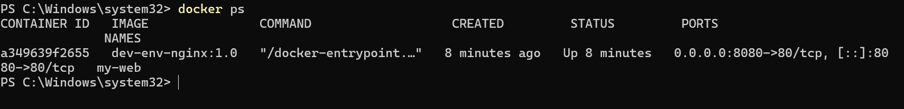

---

## 9. 컨테이너 실행 실습

### 9.1 hello-world


```powershell
PS C:\dev\dev-env-setup> docker run hello-world

Hello from Docker!
This message shows that your installation appears to be working correctly.

To generate this message, Docker took the following steps:
 1. The Docker client contacted the Docker daemon.
 2. The Docker daemon pulled the "hello-world" image from the Docker Hub.
    (amd64)
 3. The Docker daemon created a new container from that image which runs the
    executable that produces the output you are currently reading.
 4. The Docker daemon streamed that output to the Docker client, which sent it
    to your terminal.
```

### 9.2 ubuntu 컨테이너


```powershell
PS C:\dev\dev-env-setup> docker run -it --name my-ubuntu ubuntu bash
Unable to find image 'ubuntu:latest' locally
latest: Pulling from library/ubuntu
f3f25b84a7d7: Pull complete
edafa32f5d9e: Pull complete
21594acc2d8b: Download complete
Status: Downloaded newer image for ubuntu:latest
root@23ec7a648b72:/# ls
bin  boot  dev  etc  home  lib  lib64  media  mnt  opt  proc  root  run  sbin  srv  sys  tmp  usr  var
root@23ec7a648b72:/# echo "hello from container"
hello from container
root@23ec7a648b72:/# exit
exit

PS C:\dev\dev-env-setup> docker ps -a
CONTAINER ID   IMAGE               COMMAND                   CREATED              STATUS                     PORTS                                     NAMES
23ec7a648b72   ubuntu              "bash"                    About a minute ago   Exited (0) 5 seconds ago                                             my-ubuntu
a5f80fb3ec0b   hello-world         "/hello"                  2 minutes ago        Exited (0) 2 minutes ago                                             elastic_diffie
b36b991056c0   dev-env-nginx:1.0   "/docker-entrypoint.…"   20 minutes ago       Up 20 minutes              0.0.0.0:8081->80/tcp, [::]:8081->80/tcp   my-web-8081
e755f7c6e2f6   dev-env-nginx:1.0   "/docker-entrypoint.…"   31 minutes ago       Up 10 minutes              0.0.0.0:8080->80/tcp, [::]:8080->80/tcp   my-web
```

### 9.3 attach vs exec 비교


```powershell
PS C:\dev\dev-env-setup> docker start my-ubuntu
my-ubuntu

# (1) exec: 새로운 bash를 하나 더 열어서 들어감
PS C:\dev\dev-env-setup> docker exec -it my-ubuntu bash
root@23ec7a648b72:/# docker ps
bash: docker: command not found        ← 컨테이너 안에는 docker가 없음 (격리 확인)
root@23ec7a648b72:/# exit
exit

PS C:\dev\dev-env-setup> docker ps
CONTAINER ID   IMAGE               COMMAND                   CREATED          STATUS          PORTS                                     NAMES
23ec7a648b72   ubuntu              "bash"                    6 minutes ago    Up 2 minutes                                              my-ubuntu
b36b991056c0   dev-env-nginx:1.0   "/docker-entrypoint.…"   26 minutes ago   Up 26 minutes   0.0.0.0:8081->80/tcp, [::]:8081->80/tcp   my-web-8081
e755f7c6e2f6   dev-env-nginx:1.0   "/docker-entrypoint.…"   37 minutes ago   Up 15 minutes   0.0.0.0:8080->80/tcp, [::]:8080->80/tcp   my-web

# (2) attach: 컨테이너의 원래(메인) bash에 붙음
PS C:\dev\dev-env-setup> docker attach my-ubuntu
root@23ec7a648b72:/# exit
exit

PS C:\dev\dev-env-setup> docker ps -a
CONTAINER ID   IMAGE               COMMAND                   CREATED          STATUS                      PORTS                                     NAMES
23ec7a648b72   ubuntu              "bash"                    7 minutes ago    Exited (0) 13 seconds ago                                             my-ubuntu
a5f80fb3ec0b   hello-world         "/hello"                  8 minutes ago    Exited (0) 8 minutes ago                                              elastic_diffie
b36b991056c0   dev-env-nginx:1.0   "/docker-entrypoint.…"   27 minutes ago   Up 27 minutes               0.0.0.0:8081->80/tcp, [::]:8081->80/tcp   my-web-8081
e755f7c6e2f6   dev-env-nginx:1.0   "/docker-entrypoint.…"   37 minutes ago   Up 16 minutes               0.0.0.0:8080->80/tcp, [::]:8080->80/tcp   my-web
```

**관찰 결과 정리**

| 구분 | `docker exec` | `docker attach` |
|---|---|---|
| 동작 | 컨테이너 안에 **새 프로세스**(bash)를 추가로 실행 | 컨테이너의 **메인 프로세스**에 화면만 연결 |
| `exit` 하면 | 내가 연 bash만 종료 → 컨테이너는 **계속 실행** | 메인 프로세스가 종료 → 컨테이너도 **종료** |
| 언제 쓰나 | 실행 중인 서버에 들어가서 점검할 때 | 메인 프로세스의 출력을 직접 볼 때 |

> 💡 attach 상태에서 컨테이너를 끄지 않고 빠져나오려면 `Ctrl + P` → `Ctrl + Q` 를 누릅니다.

---

## 10. Dockerfile 커스텀 이미지

### 10.1 선택한 방식: (A) 웹 서버 베이스 이미지 + 콘텐츠 교체

- **베이스 이미지:** `nginx:alpine` (공식 NGINX 이미지의 경량 Alpine Linux 버전)
- **선택 이유:** 웹 서버가 이미 설치·설정되어 있어서, 보여줄 페이지만 바꾸면 바로 웹 서비스를 띄울 수 있음

### 10.2 Dockerfile

```dockerfile
# 베이스 이미지: 가벼운 NGINX 웹서버
FROM nginx:alpine

# 작성자 정보
LABEL maintainer="KANG YERIM"
LABEL description="개발 환경 구축 과제용 커스텀 NGINX 이미지"

# 작업 디렉토리 설정
WORKDIR /usr/share/nginx/html

# 기본 index.html을 커스텀 페이지로 교체 (한글 깨짐 방지를 위해 charset 지정)
RUN echo '<!DOCTYPE html><html><head><meta charset="UTF-8"><title>Dev Env Setup</title></head><body style="font-family:sans-serif;text-align:center;padding:50px;"><h1>Hello from KANG YERIM Docker!</h1><p>개발 환경 구축 과제 성공!</p></body></html>' > index.html

# 80번 포트 노출
EXPOSE 80

# NGINX 실행
CMD ["nginx", "-g", "daemon off;"]
```

### 10.3 커스텀 포인트와 목적

| 커스텀 포인트 | 목적 |
|---|---|
| `LABEL maintainer / description` | 이미지 제작자와 용도를 메타데이터로 기록 (`docker inspect`로 확인 가능) |
| `WORKDIR /usr/share/nginx/html` | 이후 명령이 실행될 기준 폴더 지정 = NGINX가 웹 페이지를 읽는 폴더 |
| `RUN echo ... > index.html` | NGINX 기본 환영 페이지를 나만의 페이지로 교체 |
| `<meta charset="UTF-8">` | 한글이 깨지지 않도록 문자 인코딩 지정 ([트러블슈팅 2](#트러블슈팅-2-브라우저에서-한글이-깨져-보임)) |
| `EXPOSE 80` | 컨테이너가 80번 포트를 사용한다는 것을 문서화 |
| `CMD [...]` | 컨테이너 시작 시 NGINX를 포그라운드로 실행 (백그라운드로 가면 컨테이너가 바로 종료됨) |

### 10.4 빌드 및 실행

````powershell
PS C:\dev\dev-env-setup> docker build -t dev-env-nginx:1.0 .
[+] Building 0.5s (7/7) FINISHED                                     docker:desktop-linux
 => [internal] load build definition from Dockerfile                                0.0s
 => => transferring dockerfile: 767B                                                0.0s
 => [internal] load metadata for docker.io/library/nginx:alpine                     0.0s
 => [internal] load .dockerignore                                                   0.0s
 => [1/3] FROM docker.io/library/nginx:alpine@sha256:785835ea65db...                0.0s
 => CACHED [2/3] WORKDIR /usr/share/nginx/html                                      0.0s
 => [3/3] RUN echo '<!DOCTYPE html><html><head><meta charset="UTF-8">...            0.2s
 => exporting to image                                                              0.2s
 => => naming to docker.io/library/dev-env-nginx:1.0                                0.0s
 => => unpacking to docker.io/library/dev-env-nginx:1.0                             0.0s

PS C:\dev\dev-env-setup> docker run -d -p 8080:80 --name my-web dev-env-nginx:1.0
e755f7c6e2f6098fb2442f36b0ebf9eea598675922288376ba057dac76905b43

PS C:\dev\dev-env-setup> docker ps
CONTAINER ID   IMAGE               COMMAND                   CREATED         STATUS         PORTS                                     NAMES
e755f7c6e2f6   dev-env-nginx:1.0   "/docker-entrypoint.…"   8 seconds ago   Up 7 seconds   0.0.0.0:8080->80/tcp, [::]:8080->80/tcp   my-web
```

---

## 11. 포트 매핑 접속

**구조:** `내 PC의 8080 포트` → `컨테이너의 80 포트(NGINX)`

```
브라우저 ──▶ localhost:8080 ──(포트 매핑 -p 8080:80)──▶ 컨테이너:80 ──▶ NGINX
```

### 11.1 8080 포트 접속


```powershell
PS> curl.exe http://localhost:8080
<!DOCTYPE html><html><head><meta charset="UTF-8"><title>Dev Env Setup</title></head><body style="font-family:sans-serif;text-align:center;padding:50px;"><h1>Hello from KANG YERIM Docker!</h1><p>개발 환경 구축 과제 성공!</p></body></html>
```

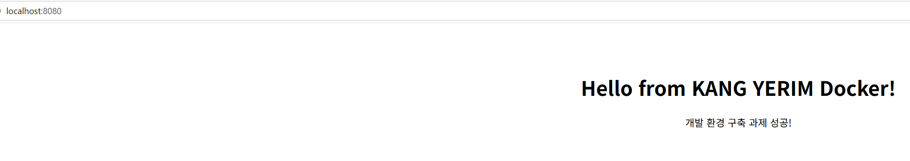

### 11.2 같은 이미지를 8081 포트로 한 번 더 실행


```powershell
PS C:\dev\dev-env-setup> docker run -d -p 8081:80 --name my-web-8081 dev-env-nginx:1.0
b36b991056c075040e3dfe478ba756aa9605870a44b562bd5f410698a59a3590

PS C:\dev\dev-env-setup> docker ps
CONTAINER ID   IMAGE               COMMAND                   CREATED          STATUS          PORTS                                     NAMES
b36b991056c0   dev-env-nginx:1.0   "/docker-entrypoint.…"   6 seconds ago    Up 5 seconds    0.0.0.0:8081->80/tcp, [::]:8081->80/tcp   my-web-8081
e755f7c6e2f6   dev-env-nginx:1.0   "/docker-entrypoint.…"   10 minutes ago   Up 10 minutes   0.0.0.0:8080->80/tcp, [::]:8080->80/tcp   my-web

PS C:\dev\dev-env-setup> curl.exe http://localhost:8081
<!DOCTYPE html><html><head><meta charset="UTF-8"><title>Dev Env Setup</title></head><body style="font-family:sans-serif;text-align:center;padding:50px;"><h1>Hello from KANG YERIM Docker!</h1><p>개발 환경 구축 과제 성공!</p></body></html>
```

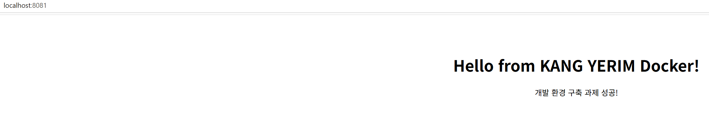
> 💡 PowerShell에서 그냥 `curl`은 다른 명령(`Invoke-WebRequest`)으로 동작하므로 `curl.exe`로 입력합니다.

---

## 12. 바인드 마운트 반영

**바인드 마운트:** 내 PC의 폴더(`./html`)를 컨테이너 폴더(`/usr/share/nginx/html`)에 **직접 연결**. 내 PC에서 파일을 고치면 이미지를 다시 빌드하지 않아도 바로 반영됩니다.

### 12.1 실행 명령

`docker-compose.yml`의 `volumes: - ./html:/usr/share/nginx/html` 설정으로 바인드 마운트를 연결했습니다.

```powershell
PS C:\dev\dev-env-setup> docker compose up -d
[+] up 2/2
 ✔ Network dev-env-setup_default Created
 ✔ Container dev-web             Started

PS C:\dev\dev-env-setup> docker ps
CONTAINER ID   IMAGE          COMMAND                   CREATED         STATUS         PORTS                                     NAMES
1b80d62a6c0d   nginx:alpine   "/docker-entrypoint.…"   9 seconds ago   Up 8 seconds   0.0.0.0:8080->80/tcp, [::]:8080->80/tcp   dev-web
```

같은 동작을 `docker run`으로 쓰면 아래와 같습니다.

```powershell
docker run -d -p 8080:80 -v ${PWD}/html:/usr/share/nginx/html --name dev-web nginx:alpine
```

### 12.2 변경 전 / 후 비교

**① 변경 전** — 호스트 파일 내용과 웹 응답

```powershell
PS C:\dev\dev-env-setup> type html\index.html -Encoding UTF8
...
<h1>🚀 Docker 마스터!</h1>
<p>바인드 마운트 완벽 이해! ✨</p>
<p>오늘도 열심히 공부 중! 💪</p>
...

PS C:\dev\dev-env-setup> curl.exe http://localhost:8080
...
<h1>🚀 Docker 마스터!</h1>
<p>바인드 마운트 완벽 이해! ✨</p>
<p>오늘도 열심히 공부 중! 💪</p>
...
```

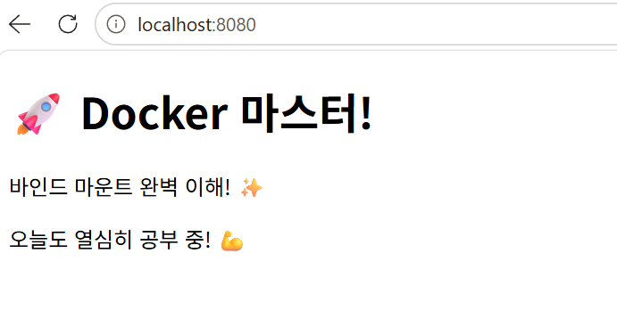

**② 호스트(내 PC)에서 `html/index.html` 수정** — VSCode에서 마지막 문장만 변경 후 저장

```diff
- <p>오늘도 열심히 공부 중! 💪</p>
+ <p>바인드 마운트 수정 테스트 성공!</p>
```

**③ 변경 후** — 컨테이너 재시작·재빌드 없이 바로 반영됨

```powershell
PS C:\dev\dev-env-setup> type html\index.html -Encoding UTF8
...
<p>바인드 마운트 완벽 이해! ✨</p>
<p>바인드 마운트 수정 테스트 성공!</p>
...

PS C:\dev\dev-env-setup> curl.exe http://localhost:8080
...
<p>바인드 마운트 완벽 이해! ✨</p>
<p>바인드 마운트 수정 테스트 성공!</p>
...
```

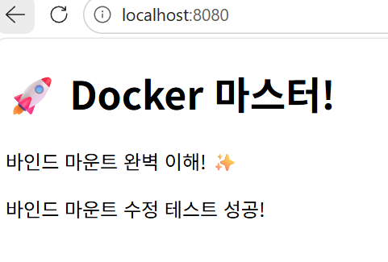

**결론:** 호스트의 `html/` 폴더와 컨테이너의 `/usr/share/nginx/html`이 연결되어 있어서, 내 PC에서 파일을 고치면 컨테이너에 **즉시** 반영된다.
---

## 13. Docker 볼륨 영속성

**볼륨:** Docker가 직접 관리하는 저장 공간. 컨테이너를 삭제해도 볼륨 안의 데이터는 남습니다.


```powershell
# 1) 볼륨 생성 및 확인
PS> docker volume create mydata
mydata
PS> docker volume ls
DRIVER    VOLUME NAME
local     mydata

# 2) 볼륨을 연결한 컨테이너 실행 후 데이터 쓰기
PS> docker run -d --name vol-test -v mydata:/data ubuntu sleep infinity
d5dbcab18cc857fad7a1dee56fbfebe867f0ae7fc745cb61b596727aff2ee0c3
PS> docker exec vol-test bash -c "echo 'volume persistence test' > /data/hello.txt"
PS> docker exec vol-test cat /data/hello.txt
volume persistence test

# 3) 컨테이너 삭제 → 목록에서 vol-test 사라짐
PS> docker rm -f vol-test
vol-test
PS> docker ps -a
CONTAINER ID   IMAGE          COMMAND                   CREATED          STATUS                      PORTS                                     NAMES
1b80d62a6c0d   nginx:alpine   "/docker-entrypoint.…"   10 minutes ago   Up 10 minutes               0.0.0.0:8080->80/tcp, [::]:8080->80/tcp   dev-web
23ec7a648b72   ubuntu         "bash"                    22 minutes ago   Exited (0) 15 minutes ago                                             my-ubuntu
a5f80fb3ec0b   hello-world    "/hello"                  23 minutes ago   Exited (0) 23 minutes ago                                             elastic_diffie

# 4) 새 컨테이너에 같은 볼륨 연결 → 데이터가 그대로 남아 있음
PS> docker run -d --name vol-test2 -v mydata:/data ubuntu sleep infinity
355fa5d7068e0d0335c6c30b8e0be5352bf7ba8a8a94ab2fe1868981cbae137f
PS> docker exec vol-test2 cat /data/hello.txt
volume persistence test
```

**결론:** 컨테이너(`vol-test`)를 삭제한 뒤 새 컨테이너(`vol-test2`)에서도 `hello.txt`가 그대로 남아 있음 → 데이터가 컨테이너가 아닌 **볼륨에 저장**되기 때문.

---

## 14. Git 설정 및 GitHub/VSCode 연동

### 14.1 Git 사용자 정보 및 기본 브랜치 설정


```powershell
PS> git --version
git version 2.56.0.windows.4

PS> git config --global user.name "KANG YERIM"
PS> git config --global user.email "****@naver.com"
PS> git config --global init.defaultBranch main

PS> git config --list
diff.astextplain.textconv=astextplain
filter.lfs.clean=git-lfs clean -- %f
filter.lfs.smudge=git-lfs smudge -- %f
filter.lfs.process=git-lfs filter-process
filter.lfs.required=true
http.sslbackend=schannel
core.autocrlf=true
core.fscache=true
core.symlinks=false
pull.rebase=false
credential.helper=manager
credential.https://dev.azure.com.usehttppath=true
init.defaultbranch=master
user.name=KANG YERIM
user.email=****@naver.com
init.defaultbranch=main
```
> 💡 `init.defaultbranch`가 두 번 나오는 이유: 위의 `master`는 Git 설치 시 정해진 **시스템 설정**, 아래의 `main`은 내가 설정한 **사용자(global) 설정**입니다. Git은 나중에 읽은 사용자 설정을 우선 적용하므로, 앞으로 새로 만드는 저장소는 `main` 브랜치로 시작합니다. (이 저장소는 기존 `master` 브랜치를 그대로 사용)

### 14.2 GitHub 저장소 생성 및 연동

GitHub에서 Public 저장소 생성:

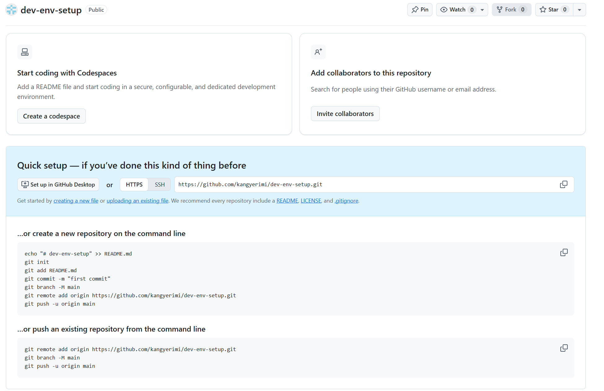

로컬로 클론:

```powershell
PS C:\dev> git clone https://github.com/kangyerimi/dev-env-setup.git
Cloning into 'dev-env-setup'...
remote: Enumerating objects: 6, done.
remote: Counting objects: 100% (6/6), done.
remote: Compressing objects: 100% (5/5), done.
remote: Total 6 (delta 0), reused 6 (delta 0), pack-reused 0 (from 0)
Receiving objects: 100% (6/6), 237.37 KiB | 21.58 MiB/s, done.
```


```powershell
PS C:\dev\dev-env-setup> git remote -v
origin  https://github.com/kangyerimi/dev-env-setup.git (fetch)
origin  https://github.com/kangyerimi/dev-env-setup.git (push)

PS C:\dev\dev-env-setup> git log --oneline
70f0315 (HEAD -> master, origin/master, origin/HEAD) 바인드 마운트, 볼륨 로그 추가
397ac3b Docker 운영, 컨테이너 실습, 포트 매핑 로그 추가
dd41696 터미널, 권한, Docker 점검 로그 추가
d8554c1 README 구조 개편, 스크린샷 이름 정리, Dockerfile 한글 깨짐 수정
f99cea7 작업 중간 백업
59d7272 개발환경 구축
```

### 14.3 VSCode GitHub 로그인 및 저장소 연동

**① VSCode에서 GitHub 계정(kangyerimi)으로 로그인한 화면**

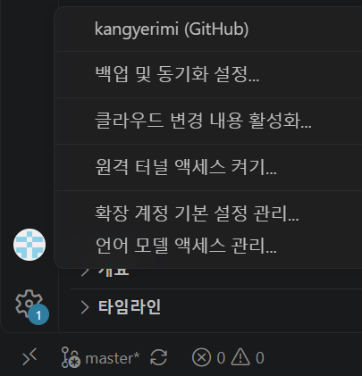

**② VSCode 소스 제어 화면** — 이 저장소의 변경 파일과 커밋 기록(그래프), 브랜치 `master`가 보임

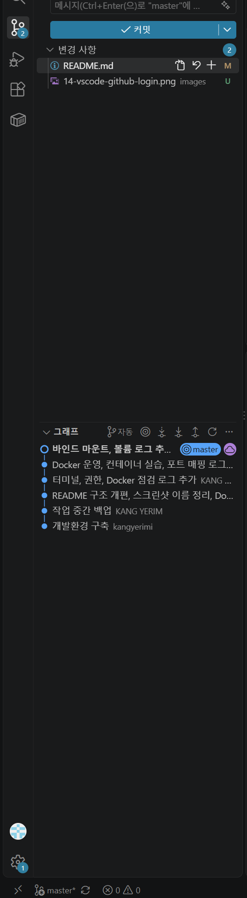

이후 VSCode의 **커밋** 버튼으로 `Git 설정 및 VSCode 연동 증거 추가` 커밋을 만들고 GitHub에 push했습니다.

---

## 15. 트러블슈팅

### 트러블슈팅 1: 바인드 마운트 후 `403 Forbidden`

| 단계 | 내용 |
|---|---|
| **문제** | `docker compose up -d` 후 `localhost:8080` 접속 시 `403 Forbidden` 표시 |
| **원인 가설** | NGINX가 보여줄 `index.html`을 찾지 못하는 것 같다 |
| **확인** | `index.html`이 `html/` 폴더 **밖**(프로젝트 루트)에 있었음. 바인드 마운트는 `./html` 폴더를 컨테이너의 `/usr/share/nginx/html`에 **덮어씌우기** 때문에, 빈 폴더가 연결되어 NGINX 기본 페이지까지 가려짐 → 보여줄 파일이 없고 폴더 목록 보기도 꺼져 있어 403 발생 |
| **해결** | `index.html`을 `html/` 폴더 안으로 이동 후 새로고침 → 정상 표시 |
| **배운 점** | 바인드 마운트는 컨테이너 안의 기존 내용을 **가린다**. 마운트할 호스트 폴더 구조를 먼저 확인해야 함 |

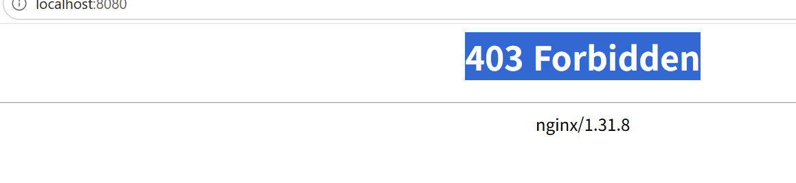

```powershell
PS C:\dev\dev-env-setup> move index.html html\
PS C:\dev\dev-env-setup> ls html

    디렉터리: C:\dev\dev-env-setup\html

Mode                 LastWriteTime         Length Name
----                 -------------         ------ ----
-a----        2026-11-04   오후 1:58            249 index.html
```

### 트러블슈팅 2: 브라우저에서 한글이 깨져 보임

| 단계 | 내용 |
|---|---|
| **문제** | 커스텀 이미지 접속 시 영어(`Hello from KANG YERIM Docker!`)는 정상인데 한글 문장이 `媛쒕컻...` 처럼 깨짐 |
| **원인 가설** | 문자 인코딩(UTF-8) 정보가 브라우저에 전달되지 않았다 |
| **확인** | ① Dockerfile의 `RUN echo` HTML에 `<meta charset="UTF-8">`이 **없었음**. ② 반면 `html/index.html`에는 meta charset이 있었고, 바인드 마운트 화면에서는 한글이 정상 표시됨 → 인코딩 지정 여부가 차이 |
| **해결** | Dockerfile의 HTML `<head>`에 `<meta charset="UTF-8">` 추가 → 재빌드 → 한글 정상 표시 |
| **배운 점** | 브라우저는 인코딩 정보가 없으면 OS 기본값(한국어 Windows는 EUC-KR 계열)으로 추측한다. 웹 페이지는 항상 UTF-8을 명시하자 |

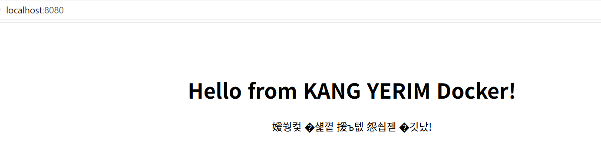

**해결 후 (한글 정상 표시):**


### 트러블슈팅 3: `docker info`에서 Docker 데몬 연결 실패

| 단계 | 내용 |
|---|---|
| **문제** | `docker info` 실행 시 `Client:` 정보는 나오지만 `Server:` 아래에 연결 실패 에러 발생 |
| **원인 가설** | docker 명령어(클라이언트)는 설치되어 있지만, 실제 일을 하는 Docker 엔진(데몬)이 실행되지 않았다 |
| **확인** | 에러 메시지에 `daemon is running`을 확인하라는 문구가 있음. 작업 표시줄에 Docker Desktop 고래 아이콘이 없었음 → Docker Desktop이 꺼져 있었음 |
| **해결** | Docker Desktop 실행 → 왼쪽 아래 `Engine running` 확인 → `docker info` 재실행 시 `Server:` 정보 정상 출력 |
| **배운 점** | Docker는 **클라이언트(명령어)** 와 **서버(데몬)** 로 나뉜다. Windows에서는 Docker Desktop을 켜야 데몬이 실행된다 |

```powershell
PS> docker info
Client:
 Version:    29.9.2
 Context:    desktop-linux
 ...
Server:
failed to connect to the docker API at npipe:////./pipe/dockerDesktopLinuxEngine; check if the path is correct and if the daemon is running: open //./pipe/dockerDesktopLinuxEngine: The system cannot find the file specified.
```

---

## 16. 검증 방법 요약

| 항목 | 검증 명령 | 확인한 것 | 증거 위치 |
|---|---|---|---|
| 터미널 조작 | `pwd`, `ls -la` 등 | 파일 생성·복사·이동·삭제 결과 | [5장](#5-터미널-조작-로그) |
| 권한 | `ls -l`, `chmod` | 권한 문자열 변경 전/후 | [6장](#6-파일-권한-실습) |
| Docker 설치 | `docker --version`, `docker info` | 버전, 데몬(Server) 동작 | [7장](#7-docker-설치-및-점검) |
| 운영 명령 | `docker ps -a`, `logs`, `stats` | 컨테이너 상태·로그·리소스 | [8장](#8-docker-기본-운영-명령) |
| 컨테이너 실행 | `docker run hello-world`, `exec`, `attach` | 실행 성공, exit 후 상태 차이 | [9장](#9-컨테이너-실행-실습) |
| 커스텀 이미지 | `docker build`, `docker run` | 빌드 성공, 컨테이너 Up | [10장](#10-dockerfile-커스텀-이미지) |
| 포트 매핑 | 브라우저, `curl.exe` | `localhost:8080`, `8081` 응답 | [11장](#11-포트-매핑-접속) |
| 바인드 마운트 | 파일 수정 후 새로고침 | 재빌드 없이 즉시 반영 | [12장](#12-바인드-마운트-반영) |
| 볼륨 | 컨테이너 삭제 후 `cat` | 데이터 유지 | [13장](#13-docker-볼륨-영속성) |
| Git/GitHub | `git config --list`, VSCode | 설정값, 로그인·연동 | [14장](#14-git-설정-및-githubvscode-연동) |

---

## 17. 개념 정리

### 17.1 절대 경로 vs 상대 경로

- **절대 경로:** 최상위(`/`)부터 시작하는 **전체 주소**. 어디서 실행해도 같은 위치를 가리킴.
  예) `/home/yerim/practice/terminal/memo.txt`
- **상대 경로:** **현재 위치 기준** 주소. `.`은 현재 폴더, `..`은 상위 폴더.
  예) 현재 위치가 `/home/yerim/practice`일 때 `terminal/memo.txt`, `../practice/terminal`
- 비유: 절대 경로는 "서울시 강남구 ○○로 12", 상대 경로는 "여기서 두 블록 앞".

### 17.2 파일 권한 (r/w/x)와 755·644

`ls -l` 결과 `-rwxr-xr-x`는 맨 앞 1글자(파일 종류: `-` 파일, `d` 디렉토리) + 3글자씩 3묶음입니다.

| 묶음 | 소유자(user) | 그룹(group) | 그 외(others) |
|---|---|---|---|
| 예시 | `rwx` | `r-x` | `r-x` |
| 숫자 | 4+2+1 = **7** | 4+0+1 = **5** | 4+0+1 = **5** |

- `r`(읽기)=4, `w`(쓰기)=2, `x`(실행)=1 을 더한 값
- **755** = 소유자는 전부 가능, 나머지는 읽기·실행만 → 실행 파일, 디렉토리에 주로 사용
- **644** = 소유자는 읽기·쓰기, 나머지는 읽기만 → 일반 파일에 주로 사용
- 디렉토리에서 `x`는 "그 폴더 안으로 들어갈(cd) 수 있는 권한"

### 17.3 커스텀 이미지

이미 만들어진 이미지(`nginx:alpine`)를 `FROM`으로 가져와 그 위에 필요한 것만 덧붙여 새 이미지를 만드는 것.
처음부터 웹 서버를 설치할 필요 없이 **"검증된 베이스 + 내 변경분"** 만 관리하면 됩니다.
이미지는 설계도(붕어빵 틀), 컨테이너는 그 설계도로 실행한 실체(붕어빵)입니다.

### 17.4 포트 매핑이 필요한 이유

컨테이너는 내 PC와 **격리된 별도 네트워크**에서 실행됩니다. 컨테이너 안의 NGINX가 80번 포트를 열어도 바깥(내 PC 브라우저)에서는 바로 접근할 수 없습니다.
`-p 8080:80`은 "내 PC 8080번으로 들어온 요청을 컨테이너 80번으로 전달하라"는 연결 통로입니다.
덕분에 같은 이미지를 8080, 8081처럼 다른 포트로 여러 개 띄울 수도 있습니다.

### 17.5 Docker 볼륨 (영속 데이터)

컨테이너 내부 파일은 컨테이너를 삭제하면 함께 사라집니다. 볼륨은 Docker가 관리하는 **컨테이너 바깥의 저장 공간**이라, 컨테이너를 지우고 새로 만들어도 데이터가 유지됩니다. (DB 데이터, 업로드 파일 등에 사용)

| 구분 | 바인드 마운트 | 볼륨 |
|---|---|---|
| 저장 위치 | 내가 지정한 호스트 폴더 (`./html`) | Docker가 관리하는 영역 |
| 주 용도 | 개발 중 코드/파일 즉시 반영 | 데이터 영구 보관 |
| 예시 옵션 | `-v ${PWD}/html:/usr/share/nginx/html` | `-v mydata:/data` |

### 17.6 Git vs GitHub

| 구분 | Git | GitHub |
|---|---|---|
| 정체 | 내 PC에 설치하는 **버전 관리 프로그램** | Git 저장소를 올려두는 **온라인 서비스** |
| 역할 | 변경 이력 저장(commit), 브랜치 관리 | 원격 백업, 공유, 협업(PR, 이슈) |
| 인터넷 | 없어도 사용 가능 | 필요 |
| 비유 | 게임의 세이브 기능 | 세이브 파일을 올리는 클라우드 |

---

## 18. 보너스: Docker Compose

`docker run` 옵션(포트, 마운트, 이름 등)을 **파일로 문서화**해서 `docker compose up` 한 줄로 같은 환경을 재현할 수 있습니다.

```yaml
services:
  web:
    image: nginx:alpine
    container_name: dev-web
    ports:
      - "8080:80"
    volumes:
      - ./html:/usr/share/nginx/html
    restart: unless-stopped
```


```powershell
PS C:\dev\dev-env-setup> docker compose ps
NAME      IMAGE          COMMAND                   SERVICE   CREATED          STATUS          PORTS
dev-web   nginx:alpine   "/docker-entrypoint.…"   web       47 minutes ago   Up 47 minutes   0.0.0.0:8080->80/tcp, [::]:8080->80/tcp

PS C:\dev\dev-env-setup> docker compose logs
dev-web  | /docker-entrypoint.sh: Configuration complete; ready for start up
dev-web  | 2026/11/08 03:49:58 [notice] 1#1: nginx/1.31.8
dev-web  | 2026/11/08 03:49:58 [notice] 1#1: start worker processes
...
dev-web  | 172.18.0.1 - - [08/Nov/2026:03:50:24 +0000] "GET / HTTP/1.1" 200 249 "-" "curl/8.21.0" "-"
dev-web  | 172.18.0.1 - - [08/Nov/2026:03:51:51 +0000] "GET / HTTP/1.1" 200 257 "-" "curl/8.21.0" "-"
dev-web  | 172.18.0.1 - - [08/Nov/2026:03:52:20 +0000] "GET / HTTP/1.1" 200 257 "-" "Mozilla/5.0 ... Edg/157.0.0.0" "-"

PS C:\dev\dev-env-setup> docker compose down
[+] down 2/2
 ✔ Container dev-web             Removed
 ✔ Network dev-env-setup_default Removed
```
> 💡 로그의 응답 크기가 `249` → `257` 바이트로 바뀐 것은 12장에서 `html/index.html`을 수정한 결과가 바인드 마운트로 즉시 반영되었음을 보여줍니다.
> `docker compose down`은 컨테이너뿐 아니라 Compose가 만든 네트워크까지 한 번에 정리합니다.

---

## 19. 재현 시 주의사항

```powershell
git clone https://github.com/kangyerimi/dev-env-setup.git
cd dev-env-setup

# 커스텀 이미지
docker build -t dev-env-nginx:1.0 .
docker run -d -p 8080:80 --name my-web dev-env-nginx:1.0
# → http://localhost:8080

# 바인드 마운트 (Compose)
docker rm -f my-web
docker compose up -d
# → http://localhost:8080, html/index.html 수정 후 새로고침
```

- **Docker Desktop이 실행 중**이어야 합니다 (트레이 아이콘의 고래가 초록색/Running).
- 8080 포트를 다른 프로그램이 쓰고 있으면 `-p 8090:80`처럼 호스트 포트만 바꾸면 됩니다.
- `${PWD}`는 PowerShell 문법입니다. Git Bash/WSL에서는 `$(pwd)`를 사용하세요.
- 권한 실습(`chmod`)은 WSL의 리눅스 홈(`~`)에서 해야 결과가 정상적으로 보입니다.

---

## 🔒 보안

- 이 문서와 스크린샷에는 비밀번호, 토큰, 개인키가 포함되어 있지 않습니다.
- `git config --list` 출력의 이메일은 마스킹했습니다.
- GitHub 인증은 VSCode 로그인(브라우저 OAuth)으로 진행하여 토큰을 직접 다루지 않았습니다.